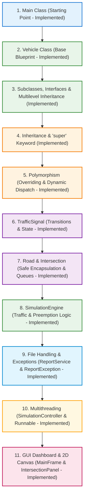

# Learn the Project: Beginner's Guide to Smart Traffic Simulator

> **Course:** CSC2104 — Object Oriented Programming (3rd Semester B.Tech CSE)  
> **Student Guide:** Plain-English, Step-by-Step Code Walkthrough  

---

## Welcome! How to Use This Guide

If you are a beginner in Java, this guide is written specifically for you. 

We avoid confusing programming jargon, complex design patterns, and advanced Java syntax (like streams and lambdas). Instead, we build the application step-by-step using **standard, clean, and simple Java** that you can easily read, write, and explain to your professors in your university viva.

---

## The 11 Steps to Understand the Project



> **Development Status Note:** Steps 1 through 11 represent **all 6 development phases** fully implemented and verified by automated unit tests (46 passing tests). The project includes the complete core domain model, simulation engine, file I/O reporting, background multithreading, and the interactive Java Swing GUI.

---

## Step 1: The Main Class

* **What it does:** Starts the entire Java program.
* **Why we need it:** Every standalone Java program must have a `public static void main(String[] args)` method as its execution starting point.
* **Important methods:** `main(String[] args)`
* **OOP concept demonstrated:** Class definition, `public`, `static`, `void`, and `final` variables.

### The Code:
```java
package com.traffic.app;

public class Main {
    // 'public static final' creates a constant value that never changes
    public static final String APP_NAME = "Smart Traffic Simulator";
    public static final String VERSION = "1.0.0";

    public static void main(String[] args) {
        System.out.println("Starting: " + APP_NAME + " v" + VERSION);
        // In later phases, this method creates the Intersection and launches the GUI
    }
}
```

### Explanation for Beginners:
* `public`: Accessible from anywhere in Java.
* `static`: Belonging to the class itself, so Java can run it without first creating an object using `new`.
* `void`: Does not return any value back.
* `String[] args`: An array of text arguments passed from the command line.

---

## Step 2: The Vehicle Class (The Base Blueprint)

* **What it does:** Holds common data (ID, speed, waiting time) shared by all vehicles.
* **Why we need it:** Instead of copying ID and speed into Car, Bike, Bus, and Ambulance, we write it once in `Vehicle`.
* **Important methods:** `getId()`, `getSpeed()`, `getWaitingTime()`, `incrementWaitingTime()`, `displayInfo()`.
* **OOP concept demonstrated:** **Abstraction** (`abstract class`), **Encapsulation** (`private` variables with `public` getters/setters), and **Input Validation** (`IllegalArgumentException`).

### The Code:
```java
package com.traffic.model;

// 'abstract' means you cannot create a direct 'new Vehicle()' object.
// You must create a specific child object like 'new Car()' or 'new Ambulance()'.
public abstract class Vehicle {
    
    // 'private' protects these variables so outside code cannot tamper with them directly (Encapsulation)
    private String id;
    private int speed;
    private int waitingTime; // Counts how many seconds this vehicle has waited at a red light

    // Constructor: Initializes the vehicle's ID and speed with validation
    public Vehicle(String id, int speed) {
        if (id == null || id.trim().isEmpty()) {
            throw new IllegalArgumentException("Vehicle ID cannot be null or empty.");
        }
        if (speed < 0) {
            throw new IllegalArgumentException("Speed cannot be negative: " + speed);
        }
        this.id = id.trim();
        this.speed = speed;
        this.waitingTime = 0; // Starts at 0
    }

    // Getters: Allow other classes to safely read the private variables
    public String getId() {
        return id;
    }

    public int getSpeed() {
        return speed;
    }

    public void setSpeed(int speed) {
        if (speed < 0) {
            throw new IllegalArgumentException("Speed cannot be negative: " + speed);
        }
        this.speed = speed;
    }

    public int getWaitingTime() {
        return waitingTime;
    }

    public void setWaitingTime(int waitingTime) {
        if (waitingTime < 0) {
            throw new IllegalArgumentException("Waiting time cannot be negative: " + waitingTime);
        }
        this.waitingTime = waitingTime;
    }

    // Increments waiting time by 1 tick/second
    public void incrementWaitingTime() {
        this.waitingTime++;
    }

    // Tells whether this vehicle is an emergency vehicle (default is false)
    public boolean isEmergency() {
        return false;
    }

    // Abstract method: Every concrete child class MUST write its own version of this method
    public abstract void displayInfo();
}
```

### Explanation for Beginners:
* **Why is `Vehicle` abstract?** A "generic vehicle" does not exist on a real road—only specific vehicles like cars, bikes, or ambulances exist. Making it `abstract` prevents someone from accidentally typing `new Vehicle()`.
* **Why do we validate input?** If an external user passes a negative speed like `-50` or a blank ID `""`, our code throws an `IllegalArgumentException` immediately. This prevents invalid data from entering our system.

---

## Step 3: Specific Vehicle Classes, Interfaces & Multilevel Inheritance

* **What they do:** Represent specific kinds of vehicles on the road with their own unique attributes and behaviors.
* **Why we need them:** A bus has passenger capacity, a bike has a helmet check, an emergency vehicle has a siren, and an ambulance has a hospital destination.
* **OOP concepts demonstrated:**
  * **Single Inheritance:** `Car extends Vehicle`, `Bike extends Vehicle`, `Bus extends Vehicle`.
  * **Interface Implementation:** `EmergencyCapable` interface defines a contract for siren and urgency operations.
  * **Multilevel Inheritance:** `Vehicle` &rarr; `EmergencyVehicle` &rarr; `Ambulance`.
  * **Method Overriding:** `@Override` provides customized behavior for `displayInfo()`.

### The Car Class:
```java
package com.traffic.model;

// 'extends Vehicle' means Car inherits all variables and methods from Vehicle
public class Car extends Vehicle {
    private int passengers;

    public Car(String id, int speed, int passengers) {
        super(id, speed); // Calls the Vehicle constructor
        if (passengers <= 0) {
            throw new IllegalArgumentException("Passenger count must be positive: " + passengers);
        }
        this.passengers = passengers;
    }

    public int getPassengers() {
        return passengers;
    }

    public void setPassengers(int passengers) {
        if (passengers <= 0) {
            throw new IllegalArgumentException("Passenger count must be positive: " + passengers);
        }
        this.passengers = passengers;
    }

    @Override
    public void displayInfo() {
        System.out.println("Car [" + getId() + "] Speed: " + getSpeed() + " km/h, Passengers: " + passengers);
    }
}
```

### The Bike Class:
```java
package com.traffic.model;

public class Bike extends Vehicle {
    private boolean hasHelmet;

    public Bike(String id, int speed, boolean hasHelmet) {
        super(id, speed);
        this.hasHelmet = hasHelmet;
    }

    public boolean isHasHelmet() {
        return hasHelmet;
    }

    public void setHasHelmet(boolean hasHelmet) {
        this.hasHelmet = hasHelmet;
    }

    @Override
    public void displayInfo() {
        System.out.println("Bike [" + getId() + "] Speed: " + getSpeed() + " km/h, Helmet: " + hasHelmet);
    }
}
```

### The Bus Class:
```java
package com.traffic.model;

public class Bus extends Vehicle {
    private int passengerCapacity;

    public Bus(String id, int speed, int passengerCapacity) {
        super(id, speed);
        if (passengerCapacity <= 0) {
            throw new IllegalArgumentException("Passenger capacity must be positive: " + passengerCapacity);
        }
        this.passengerCapacity = passengerCapacity;
    }

    public int getPassengerCapacity() {
        return passengerCapacity;
    }

    public void setPassengerCapacity(int passengerCapacity) {
        if (passengerCapacity <= 0) {
            throw new IllegalArgumentException("Passenger capacity must be positive: " + passengerCapacity);
        }
        this.passengerCapacity = passengerCapacity;
    }

    @Override
    public void displayInfo() {
        System.out.println("Bus [" + getId() + "] Speed: " + getSpeed() + " km/h, Capacity: " + passengerCapacity);
    }
}
```

### The EmergencyCapable Interface:
```java
package com.traffic.model;

// An interface specifies WHAT a class can do without dictating HOW it does it
public interface EmergencyCapable {
    boolean isEmergency();
    void activateSiren();
    void deactivateSiren();
    boolean isSirenActive();
    int getUrgencyLevel();
}
```

### The EmergencyVehicle Class (Multilevel Level 2):
```java
package com.traffic.model;

// Abstract class sitting between Vehicle and concrete emergency vehicles like Ambulance
public abstract class EmergencyVehicle extends Vehicle implements EmergencyCapable {
    private boolean sirenActive;
    private int urgencyLevel; // Scaled 1 (Lowest) to 5 (Critical)

    public EmergencyVehicle(String id, int speed, int urgencyLevel) {
        super(id, speed);
        if (urgencyLevel < 1 || urgencyLevel > 5) {
            throw new IllegalArgumentException("Urgency level must be between 1 and 5: " + urgencyLevel);
        }
        this.urgencyLevel = urgencyLevel;
        this.sirenActive = true; // Sirens active by default
    }

    @Override
    public boolean isEmergency() {
        return true;
    }

    @Override
    public void activateSiren() {
        this.sirenActive = true;
    }

    @Override
    public void deactivateSiren() {
        this.sirenActive = false;
    }

    @Override
    public boolean isSirenActive() {
        return sirenActive;
    }

    @Override
    public int getUrgencyLevel() {
        return urgencyLevel;
    }
}
```

### The Ambulance Class (Multilevel Level 3):
```java
package com.traffic.model;

// Demonstrates multilevel inheritance: Vehicle -> EmergencyVehicle -> Ambulance
public class Ambulance extends EmergencyVehicle {
    private String hospitalName;

    public Ambulance(String id, int speed, int urgencyLevel, String hospitalName) {
        super(id, speed, urgencyLevel);
        this.hospitalName = (hospitalName != null) ? hospitalName : "City General Hospital";
    }

    public String getHospitalName() {
        return hospitalName;
    }

    @Override
    public void displayInfo() {
        System.out.println("AMBULANCE [" + getId() + "] Speed: " + getSpeed() + 
            " km/h, Urgency: " + getUrgencyLevel() + "/5, Destination: " + hospitalName + 
            " (SIREN " + (isSirenActive() ? "ON" : "OFF") + ")");
    }
}
```

---

## Step 4: Inheritance and the `super` Keyword

* **What it does:** Allows child classes to reuse code and state from parent classes.
* **Why we need it:** You don't have to duplicate `getId()`, `getSpeed()`, and `waitingTime` across `Car`, `Bike`, `Bus`, `EmergencyVehicle`, and `Ambulance`.
* **Important keyword:** `super(id, speed)` passes the values up to the parent constructor.

### Mental Model of Multilevel & Hierarchical Inheritance:
```
                       +-----------------------------+
                       |       Vehicle (Parent)      |
                       | - id, speed, waitingTime    |
                       +--------------+--------------+
                                      |
         +-----------------+----------+----------+-----------------+
         |                 |                     |                 |
+--------+--------+ +------+--------+   +--------+--------+ +------+-------------------+
|   Car (Child)   | |  Bike (Child) |   |   Bus (Child)   | | EmergencyVehicle (Child)  |
| - passengers    | | - hasHelmet   |   | - capacity      | | implements EmergencyCapable|
+-----------------+ +---------------+   +-----------------+ +--------------+------------+
                                                                           |
                                                                  +--------+--------+
                                                                  |Ambulance (Child)|
                                                                  | - hospitalName  |
                                                                  +-----------------+
```

### Viva Tip:
> **Question:** Can `super()` be placed on the second line of a constructor?  
> **Answer:** No! In Java, `super()` **must** be the very first statement inside a child constructor.

---

## Step 5: Polymorphism (Dynamic Method Dispatch)

* **What it does:** Treating different child objects as their parent type (`Vehicle`), while Java automatically runs each child's specific method.
* **Why we need it:** The road queue can store cars, bikes, and ambulances in one single `ArrayList<Vehicle>`. When we call `v.displayInfo()`, Java automatically runs the correct version!

### Simple Code Example:
```java
// Create a list of parent type Vehicle
ArrayList<Vehicle> list = new ArrayList<>();

list.add(new Car("C-1", 50, 4));
list.add(new Bike("B-1", 30, true));
list.add(new Ambulance("AMB-1", 80, 5, "City Hospital"));

// Loop through the list using a single Vehicle reference 'v'
for (Vehicle v : list) {
    v.displayInfo(); // Dynamic Method Dispatch in action!
}
```

### Output:
```text
Car [C-1] Speed: 50 km/h, Passengers: 4
Bike [B-1] Speed: 30 km/h, Helmet: true
AMBULANCE [AMB-1] Speed: 80 km/h, Urgency: 5/5, Destination: City Hospital (SIREN ON)
```

---

## Step 6: TrafficSignal (Managing Red, Yellow, Green State Transitions)

* **What it does:** Tracks whether a road has a `RED`, `YELLOW`, or `GREEN` light, and counts down the remaining seconds.
* **Why we need it:** Vehicles only safely move when their road's signal is `GREEN`. A smooth transition (`GREEN` &rarr; `YELLOW` &rarr; `RED`) prevents sudden stops.
* **Important methods:** `switchToGreen()`, `switchToYellow()`, `switchToRed()`, `tick()`, `isGreen()`, `isYellow()`, `isRed()`.
* **OOP concept demonstrated:** **State Management**, `switch` statement, simple enum, and constructor validation.

### Simple Enum:
```java
package com.traffic.model;

// An enum holds fixed, type-safe choices
public enum SignalColor {
    RED,
    YELLOW,
    GREEN
}
```

### The TrafficSignal Class:
```java
package com.traffic.model;

public class TrafficSignal {
    public static final int DEFAULT_GREEN_DURATION = 10;
    public static final int DEFAULT_YELLOW_DURATION = 2;

    private SignalColor color;
    private int greenDuration;
    private int yellowDuration;
    private int timer; // Counts down seconds remaining on current color

    public TrafficSignal() {
        this(DEFAULT_GREEN_DURATION, DEFAULT_YELLOW_DURATION);
    }

    public TrafficSignal(int greenDuration) {
        this(greenDuration, DEFAULT_YELLOW_DURATION);
    }

    public TrafficSignal(int greenDuration, int yellowDuration) {
        if (greenDuration <= 0) {
            throw new IllegalArgumentException("Green duration must be positive: " + greenDuration);
        }
        if (yellowDuration <= 0) {
            throw new IllegalArgumentException("Yellow duration must be positive: " + yellowDuration);
        }
        this.greenDuration = greenDuration;
        this.yellowDuration = yellowDuration;
        this.color = SignalColor.RED; // Signals safely start at RED
        this.timer = 0;
    }

    public SignalColor getColor() {
        return color;
    }

    public int getTimer() {
        return timer;
    }

    public int getGreenDuration() {
        return greenDuration;
    }

    public int getYellowDuration() {
        return yellowDuration;
    }

    // Safe state transitions:
    public void switchToGreen() {
        this.color = SignalColor.GREEN;
        this.timer = this.greenDuration;
    }

    public void switchToYellow() {
        this.color = SignalColor.YELLOW;
        this.timer = this.yellowDuration;
    }

    public void switchToRed() {
        this.color = SignalColor.RED;
        this.timer = 0;
    }

    public boolean isGreen() {
        return this.color == SignalColor.GREEN;
    }

    public boolean isYellow() {
        return this.color == SignalColor.YELLOW;
    }

    public boolean isRed() {
        return this.color == SignalColor.RED;
    }

    // Called every second by the simulation loop
    public void tick() {
        if (timer > 0) {
            timer--;
        }
    }

    public boolean isTimerExpired() {
        return timer <= 0;
    }
}
```

---

## Step 7: Road and Intersection (Safe Encapsulation & Queues)

* **What they do:**
  * `Road`: Represents one directional approach (e.g. North). Has a FIFO queue of waiting vehicles and its own `TrafficSignal`.
  * `Intersection`: Holds all 4 approaches (North, East, South, West) together.
* **Why we need them:** To model the physical structure of a 4-way intersection without exposing internal data structures.
* **OOP concepts demonstrated:**
  * **Composition ("has-a" relationship):** `Intersection` has 4 `Road`s; each `Road` has a `TrafficSignal`.
  * **Strict Encapsulation:** `Road` never gives out its internal `ArrayList` reference directly. It returns a defensive copy (`new ArrayList<>(queue)`), protecting the queue from rogue external modifications.
  * **Array Encapsulation:** `Intersection` returns a clone copy of its `Road[]` array.

### Direction Enum:
```java
package com.traffic.model;

public enum Direction {
    NORTH,
    EAST,
    SOUTH,
    WEST
}
```

### The Road Class:
```java
package com.traffic.model;

import java.util.ArrayList;

public class Road {
    public static final int DEFAULT_MAX_CAPACITY = 20;

    private String name;
    private Direction direction;
    private int maxCapacity;
    private TrafficSignal signal;
    private ArrayList<Vehicle> queue; // Internal vehicle queue

    public Road(String name, Direction direction) {
        this(name, direction, DEFAULT_MAX_CAPACITY);
    }

    public Road(String name, Direction direction, int maxCapacity) {
        if (name == null || name.trim().isEmpty()) {
            throw new IllegalArgumentException("Road name cannot be null or empty.");
        }
        if (direction == null) {
            throw new IllegalArgumentException("Direction cannot be null.");
        }
        if (maxCapacity <= 0) {
            throw new IllegalArgumentException("Max capacity must be positive: " + maxCapacity);
        }
        this.name = name.trim();
        this.direction = direction;
        this.maxCapacity = maxCapacity;
        this.signal = new TrafficSignal();
        this.queue = new ArrayList<>();
    }

    // Add a vehicle to the back of the queue
    public boolean addVehicle(Vehicle v) {
        if (v == null || isFull()) {
            return false;
        }
        return queue.add(v);
    }

    // Remove next vehicle: emergency vehicles bypass ordinary traffic and depart first!
    public Vehicle removeVehicle() {
        if (queue.isEmpty()) {
            return null;
        }
        // Search for emergency vehicle to give it immediate lane priority
        for (int i = 0; i < queue.size(); i++) {
            if (queue.get(i).isEmergency()) {
                return queue.remove(i); // Ambulance departs first!
            }
        }
        return queue.remove(0); // Normal FIFO for commuter vehicles
    }

    public boolean isFull() {
        return queue.size() >= maxCapacity;
    }

    public boolean isEmpty() {
        return queue.isEmpty();
    }

    public int getQueueLength() {
        return queue.size();
    }

    public Vehicle getVehicle(int index) {
        if (index < 0 || index >= queue.size()) {
            return null;
        }
        return queue.get(index);
    }

    // Encapsulation Protection: Returns a defensive copy!
    // External code cannot clear or corrupt our internal queue.
    public ArrayList<Vehicle> getVehicles() {
        return new ArrayList<>(queue);
    }

    public boolean hasEmergencyVehicle() {
        for (Vehicle v : queue) {
            if (v.isEmergency()) {
                return true;
            }
        }
        return false;
    }
}
```

### The Intersection Class:
```java
package com.traffic.model;

public class Intersection {
    // Array of exactly 4 roads
    private Road[] roads;

    public Intersection() {
        roads = new Road[4];
        roads[0] = new Road("North Approach", Direction.NORTH);
        roads[1] = new Road("East Approach", Direction.EAST);
        roads[2] = new Road("South Approach", Direction.SOUTH);
        roads[3] = new Road("West Approach", Direction.WEST);
    }

    // Defensive copy protects the internal array
    public Road[] getRoads() {
        return new Road[] { roads[0], roads[1], roads[2], roads[3] };
    }

    public Road getRoad(Direction direction) {
        if (direction == null) return null;
        switch (direction) {
            case NORTH: return roads[0];
            case EAST:  return roads[1];
            case SOUTH: return roads[2];
            case WEST:  return roads[3];
            default:    return null;
        }
    }

    public Road getRoad(int index) {
        if (index < 0 || index >= roads.length) {
            return null;
        }
        return roads[index];
    }
}
```

---

## Step 8: The SimulationEngine (Phase 3 — Console Simulation & Traffic Logic)

* **What it does:** Coordinates the entire intersection on each discrete time tick (second). It updates timers, transitions lights (GREEN &rarr; YELLOW &rarr; RED), lets green vehicles depart, detects ambulances to execute safe preemption, and prevents commuter starvation.
* **Why we need it:** Decouples simulation scheduling logic from data models (`Vehicle`, `Road`, `TrafficSignal`) and user interfaces.
* **Important methods:** `tick()`, `step(int ticks)`, `findHighestUrgencyRoadIndex()`, `findStarvedRoadIndex()`, `printStatus()`.
* **OOP concepts demonstrated:**
  * **State Machine & Control Flow:** If/else and switch control flow managing phase transitions.
  * **Composition:** Operates on `Intersection` containing 4 `Road`s and their `TrafficSignal`s.
  * **Polymorphism:** Handles any `Vehicle` subclass in road queues without type-specific hacks.
  * **Algorithmic Encapsulation:** Safe preemption, emergency queue priority, and anti-starvation logic encapsulated behind clean methods.

> **Starvation Threshold:** The engine's default starvation threshold is **20 seconds** (`DEFAULT_STARVATION_THRESHOLD = 20`). The interactive console demonstration in `Main.java` explicitly configures this to **15 seconds** to allow anti-starvation to be observed in a compact terminal run. Starvation tracking applies strictly to ordinary commuter traffic; emergency vehicles are prioritized independently.

> **Note on Multithreading:** In this current phase (Phase 3), the simulation runs synchronously tick-by-tick in the console. In **Phase 5**, we will add `implements Runnable` so that it can also execute in a background `Thread` alongside the Swing GUI.

### Key Logic in SimulationEngine:
```java
package com.traffic.engine;

import com.traffic.model.*;
import java.util.ArrayList;

public class SimulationEngine {
    private Intersection intersection;
    private int currentGreenIndex;       // 0=NORTH, 1=EAST, 2=SOUTH, 3=WEST
    private int greenDuration;
    private int yellowDuration;
    private int starvationThreshold;
    private int totalVehiclesServed;
    private int totalTicks;
    private String lastEventDescription;

    public SimulationEngine(Intersection intersection, int greenDuration, int yellowDuration, int starvationThreshold) {
        this.intersection = intersection;
        this.greenDuration = greenDuration;
        this.yellowDuration = yellowDuration;
        this.starvationThreshold = starvationThreshold;
        this.totalVehiclesServed = 0;
        this.totalTicks = 0;

        // North starts GREEN, all others start RED
        this.currentGreenIndex = 0;
        intersection.getRoad(0).getSignal().switchToGreen();
    }

    // Advances the simulation by exactly 1 second
    public void tick() {
        totalTicks++;
        Road activeRoad = intersection.getRoad(currentGreenIndex);
        TrafficSignal activeSignal = activeRoad.getSignal();

        // 1. Safe Emergency Preemption Check
        int emergencyRoadIdx = findHighestUrgencyRoadIndex();
        boolean emergencyOnOtherRoad = (emergencyRoadIdx != -1 && emergencyRoadIdx != currentGreenIndex);
        boolean starvationActive = (findStarvedRoadIndex() != -1);

        if (emergencyOnOtherRoad && !starvationActive && activeSignal.isGreen()) {
            // Do NOT abruptly change to another green!
            // Curtail green phase safely by switching to YELLOW
            activeSignal.switchToYellow();
        } else {
            // 2. Vehicle Departure during GREEN
            if (activeSignal.isGreen() && !activeRoad.isEmpty()) {
                Vehicle departing = activeRoad.removeVehicle();
                if (departing != null) {
                    totalVehiclesServed++;
                }
            }

            activeSignal.tick();

            // 3. Phase Transitions when Timer Expires
            if (activeSignal.isTimerExpired()) {
                if (activeSignal.isGreen()) {
                    // GREEN -> YELLOW
                    activeSignal.switchToYellow();
                } else if (activeSignal.isYellow()) {
                    // YELLOW -> RED -> next road GREEN
                    activeSignal.switchToRed();

                    // Select next road: Anti-Starvation > Highest Urgency Ambulance > Round-Robin
                    currentGreenIndex = determineNextRoadIndex();
                    intersection.getRoad(currentGreenIndex).getSignal().switchToGreen();
                }
            }
        }

        // 4. Increment Waiting Times for all vehicles in queues
        for (int i = 0; i < intersection.getRoadCount(); i++) {
            for (Vehicle v : intersection.getRoad(i).getVehicles()) {
                v.incrementWaitingTime();
            }
        }
    }
}
```

---

## Step 9: File Handling and Custom Exceptions (Phase 4 — Implemented)

* **What it does:** Generates a structured simulation report (`traffic_report.txt`), writes it to disk using `FileWriter`, reads it back with `FileReader` and `BufferedReader`, and wraps I/O errors into a meaningful custom checked exception `ReportException`.
* **Why we need it:** When a traffic simulation finishes, we must persist the final statistics (ticks, vehicles served, emergency vehicles served, road queues) to a file on disk so the results can be audited, reviewed, or shared without being lost when the console closes.
* **Important methods:**
  * `ReportService.generateReport(SimulationEngine engine, String filePath)`
  * `ReportService.readReport(String filePath)`
  * `ReportService.displayReport(String filePath)`
  * `ReportService.formatReport(SimulationEngine engine)`
* **OOP and Java concepts demonstrated:**
  * **Custom Checked Exception:** `ReportException extends Exception` with constructor chaining `super(message, cause)`.
  * **File Writing:** `FileWriter` for character-based text writing.
  * **File Reading with Buffering:** `FileReader` wrapped in `BufferedReader` to read text efficiently line by line using `readLine()`.
  * **Exception Handling & Resource Management:** `try`, `catch`, and explicit resource cleanup in `finally` blocks.

### 1. The Custom Exception (`ReportException.java`):
```java
package com.traffic.service;

// Checked exception: callers MUST handle it with try-catch or declare it with 'throws'
public class ReportException extends Exception {

    // Single-argument constructor passes message to java.lang.Exception
    public ReportException(String message) {
        super(message);
    }

    // Two-argument constructor chains both the message and the root cause (e.g., IOException)
    public ReportException(String message, Throwable cause) {
        super(message, cause);
    }
}
```

### 2. The Report Service (`ReportService.java`):
```java
package com.traffic.service;

import java.io.BufferedReader;
import java.io.File;
import java.io.FileReader;
import java.io.FileWriter;
import java.io.IOException;
import com.traffic.engine.SimulationEngine;

public class ReportService {

    // Writes the simulation report to disk
    public void generateReport(SimulationEngine engine, String filePath) throws ReportException {
        if (engine == null) {
            throw new IllegalArgumentException("Simulation engine cannot be null.");
        }
        if (filePath == null || filePath.trim().isEmpty()) {
            throw new IllegalArgumentException("File path cannot be null or empty.");
        }

        String content = formatReport(engine);
        FileWriter writer = null;

        try {
            File file = new File(filePath);
            File parentDir = file.getParentFile();
            if (parentDir != null && !parentDir.exists()) {
                parentDir.mkdirs();
            }

            writer = new FileWriter(file);
            writer.write(content);
            writer.flush();
        } catch (IOException e) {
            // Wrap the lower-level IOException in our clean, domain-specific ReportException
            throw new ReportException("Failed to write traffic report to: " + filePath, e);
        } finally {
            // 'finally' ALWAYS runs, guaranteeing the file handle is closed even if an error occurs
            if (writer != null) {
                try {
                    writer.close();
                } catch (IOException closeEx) {
                    System.err.println("Warning: Failed to close writer: " + closeEx.getMessage());
                }
            }
        }
    }

    // Reads the saved report back into memory line by line
    public String readReport(String filePath) throws ReportException {
        if (filePath == null || filePath.trim().isEmpty()) {
            throw new IllegalArgumentException("File path cannot be null or empty.");
        }

        File file = new File(filePath);
        if (!file.exists()) {
            throw new ReportException("Report file does not exist: " + filePath);
        }

        BufferedReader bufferedReader = null;
        try {
            bufferedReader = new BufferedReader(new FileReader(file));
            StringBuilder sb = new StringBuilder();
            String line;
            while ((line = bufferedReader.readLine()) != null) {
                sb.append(line).append(System.lineSeparator());
            }
            return sb.toString();
        } catch (IOException e) {
            throw new ReportException("Failed to read traffic report from: " + filePath, e);
        } finally {
            if (bufferedReader != null) {
                try {
                    bufferedReader.close();
                } catch (IOException closeEx) {
                    System.err.println("Warning: Failed to close reader: " + closeEx.getMessage());
                }
            }
        }
    }
}
```

### Explanation for Beginners:
* **Why use `try-catch-finally`?** File operations can fail for external reasons (e.g. disk full, permission denied, folder not found). The `try` block attempts the operation, the `catch` block catches any error and transforms it into our `ReportException`, and the `finally` block **always runs** to close the file so your operating system does not run out of file handles.
* **Why `BufferedReader`?** Reading a file character by character from hard disk is slow. `BufferedReader` buffers a chunk of text in RAM and provides the convenient `readLine()` method, returning `null` when reaching the end of the file.

---

## Step 10: Multithreading & The Simulation Controller (Phase 5 — Implemented)

* **What it does:** Runs the simulation tick loop on a dedicated background `Thread` using `SimulationController implements Runnable`, allowing the user or caller thread to start, pause, resume, adjust speed, and stop without freezing.
* **Why we need it:** If the simulation's continuous while-loop ran directly on the main thread (or the future Swing GUI event thread), the program would become unresponsive and freeze. A background worker thread allows the simulation clock to tick independently while the main thread accepts user commands.
* **Important methods:**
  * `controller.start()` — Spawns and starts the background worker thread (`new Thread(this)`).
  * `controller.pause()` — Sets `paused = true`, causing the background thread to suspend inside `wait()`.
  * `controller.resume()` — Sets `paused = false` and calls `pauseLock.notifyAll()` to wake up the worker.
  * `controller.stop()` — Sets `running = false`, wakes up the thread, interrupts any `Thread.sleep()`, and cleanly terminates the thread.
  * `controller.join()` — Pauses the calling thread until the worker thread has completely died.
  * `controller.run()` — The core loop executed on the background worker thread.
* **OOP and Java concepts demonstrated:**
  * **Multithreading via `Runnable`:** Implementing `Runnable` decouples the threading task from class inheritance (CSC2104 Lectures 40–41).
  * **Thread Lifecycle & `Thread.sleep()`:** Demonstrates thread states (`NEW`, `RUNNABLE`, `TIMED_WAITING`, `WAITING`, `TERMINATED`) and controls simulation tick interval (Lectures 42–43).
  * **Inter-Thread Communication (`wait()` and `notifyAll()`):** Uses a dedicated `pauseLock` monitor object to pause tick progression with **zero CPU consumption** (Lecture 46).
  * **`volatile` Keyword:** `volatile boolean running` and `volatile boolean paused` ensure state changes are immediately visible across thread CPU caches (Lecture 47).
  * **Safe Termination:** Avoids dangerous, deprecated methods like `Thread.stop()` or `Thread.suspend()` by using cooperative flags and thread interruption (Lecture 47).

### The Code (`SimulationController.java`):
```java
package com.traffic.engine;

public class SimulationController implements Runnable {

    private final SimulationEngine engine;
    private volatile int tickDelayMs;
    private Thread workerThread;

    // 'volatile' ensures changes made by one thread are immediately visible to all other threads
    private volatile boolean running;
    private volatile boolean paused;

    // Dedicated lock object used for wait() and notifyAll() inter-thread coordination
    private final Object pauseLock = new Object();

    public SimulationController(SimulationEngine engine, int tickDelayMs) {
        if (engine == null) {
            throw new IllegalArgumentException("Simulation engine cannot be null.");
        }
        if (tickDelayMs <= 0) {
            throw new IllegalArgumentException("Tick delay must be positive: " + tickDelayMs);
        }
        this.engine = engine;
        this.tickDelayMs = tickDelayMs;
        this.running = false;
        this.paused = false;
    }

    public synchronized void start() {
        if (running && paused) {
            resume();
            return;
        }
        if (running && workerThread != null && workerThread.isAlive()) {
            return; // Already actively running
        }

        running = true;
        paused = false;
        workerThread = new Thread(this, "TrafficSimulation-WorkerThread");
        workerThread.start(); // Spawns new OS thread and invokes run()
    }

    public void pause() {
        paused = true;
    }

    public void resume() {
        synchronized (pauseLock) {
            paused = false;
            pauseLock.notifyAll(); // Wakes up the worker thread waiting in wait()
        }
    }

    public synchronized void stop() {
        running = false;
        paused = false;
        synchronized (pauseLock) {
            pauseLock.notifyAll(); // Wake up thread if waiting in pause
        }
        if (workerThread != null) {
            workerThread.interrupt(); // Interrupt Thread.sleep() to terminate immediately
        }
    }

    @Override
    public void run() {
        while (running) {
            // 1. If paused, enter WAITING state without burning CPU cycles
            synchronized (pauseLock) {
                while (paused && running) {
                    try {
                        pauseLock.wait(); // Releases lock and waits until notifyAll()
                    } catch (InterruptedException e) {
                        Thread.currentThread().interrupt();
                        return;
                    }
                }
            }

            if (!running) {
                break;
            }

            // 2. Advance simulation by one tick
            engine.tick();

            // 3. Sleep for the configured interval (TIMED_WAITING)
            try {
                Thread.sleep(tickDelayMs);
            } catch (InterruptedException e) {
                Thread.currentThread().interrupt(); // Restore interrupted status
                break;
            }
        }
    }
}
```

### Explanation for Beginners:
* **Why implement `Runnable` instead of extending `Thread`?** In Java, a class can only extend one class (`single inheritance`). If `SimulationController` extended `Thread`, it could never extend any other base class. Implementing `Runnable` separates the code to run from the actual thread mechanism.
* **Why avoid `Thread.stop()` and `Thread.suspend()`?** Both methods are deprecated because they are unsafe. `Thread.stop()` kills a thread abruptly while it might be halfway through modifying an intersection or queue, leaving data permanently corrupted. `Thread.suspend()` can easily cause deadlocks. Our design uses cooperative `volatile boolean` flags and `interrupt()`.
* **Why use `pauseLock.wait()` instead of an empty `while (paused) {}` loop?** An empty while-loop (busy waiting) would consume 100% CPU on your computer just checking a flag. `wait()` puts the thread to sleep in the operating system scheduler until `notifyAll()` wakes it up, using 0% CPU while paused.

---

## Step 11: The Graphical User Interface (Phase 6 — Implemented)

* **What it does:** Provides an interactive Java Swing dashboard (`MainFrame`) featuring a top-down 2D canvas (`IntersectionPanel`) rendering the 4-way intersection, traffic signal housings with glowing bulbs and countdown timers, queued commuter vehicles (blue cars, orange buses, purple bikes), white emergency ambulances with red cross symbols, live controls, interactive vehicle injection, and an audit report viewer.
* **Why we need it:** Transforms an abstract console simulation into a visual, interactive demonstration where evaluators and students can directly observe emergency vehicle preemption, traffic signal phase transitions, and queue behavior in real time.
* **Important classes & methods:**
  * `IntersectionPanel.paintComponent(Graphics g)` — Uses standard 2D Java geometry (`Graphics2D`, anti-aliasing, rounded rectangles, custom strokes) to draw crossroads, signals, and vehicle queues.
  * `MainFrame.startUiRefreshTimer()` — Uses a `javax.swing.Timer` (50ms interval) to refresh canvas rendering and update statistics smoothly at 20 Hz on the Event Dispatch Thread (EDT).
  * `MainFrame.injectSelectedVehicle()` — Allows runtime injection of cars, buses, bikes, or emergency ambulances (urgency 1–5) onto any approach.
  * `MainFrame.handleGenerateReport()` & `MainFrame.handleViewReport()` — Saves audit metrics to `traffic_report.txt` and opens a modal dialog displaying the full report text.
* **OOP and Java concepts demonstrated:**
  * **Inheritance in GUI:** `MainFrame extends JFrame` (top-level window), `IntersectionPanel extends JPanel` (canvas).
  * **Custom 2D Graphics:** Overriding `paintComponent(Graphics g)` and casting to `Graphics2D` with `RenderingHints.KEY_ANTIALIASING`.
  * **Event-Driven Programming:** `ActionListener` interfaces and anonymous inner classes handling button clicks (`addActionListener`).
  * **Thread Safety in Swing:** Guaranteeing that GUI modifications and component repainting occur strictly on the Swing **Event Dispatch Thread (EDT)** using `javax.swing.Timer` and `SwingUtilities.invokeLater()`.

### Code Walkthrough: How the 2D Canvas Renders (`IntersectionPanel.java`)
```java
@Override
protected void paintComponent(Graphics g) {
    super.paintComponent(g);
    Graphics2D g2d = (Graphics2D) g;

    // Enable smooth anti-aliased geometry and text rendering
    g2d.setRenderingHint(RenderingHints.KEY_ANTIALIASING, RenderingHints.VALUE_ANTIALIAS_ON);
    g2d.setRenderingHint(RenderingHints.KEY_TEXT_ANTIALIASING, RenderingHints.VALUE_TEXT_ANTIALIAS_ON);

    // 1. Draw Asphalt Roads & Crossroads Box
    drawRoads(g2d, width, height, centerX, centerY, roadWidth);

    // 2. Draw Yellow Center Dividers & White Stop Lines
    drawLaneMarkings(g2d, width, height, centerX, centerY, roadWidth);

    // 3. Draw 4 Traffic Light Housings with Active RED/YELLOW/GREEN Bulbs & Timers
    drawTrafficSignals(g2d, intersection, centerX, centerY, roadWidth);

    // 4. Draw Vehicles in their Respective Approach Lanes
    drawVehicles(g2d, intersection, centerX, centerY, roadWidth);
}
```

### Explanation for Beginners:
* **Why `super.paintComponent(g)`?** It cleans the canvas background before painting the new frame, preventing visual artifacts and smearing.
* **Why use `javax.swing.Timer` instead of calling GUI methods from the simulation worker thread?** Swing components are **not thread-safe**. If a background thread directly calls `label.setText()` or `panel.repaint()`, it can cause race conditions, broken visual states, and random deadlocks. `javax.swing.Timer` guarantees that its callback executes safely on the Swing EDT.

---

## Summary Checklist for Your Viva

| Concept | Where It Is Used | What to Say in the Viva |
| :--- | :--- | :--- |
| **Abstract Class** | `Vehicle`, `EmergencyVehicle` | "We cannot create a generic vehicle; it is a template for concrete vehicles." |
| **Interface** | `EmergencyCapable`, `Runnable` | "Defines capabilities (`activateSiren()`, `run()`) without forcing unrelated classes into an inheritance hierarchy." |
| **Multilevel Inheritance** | `Vehicle` &rarr; `EmergencyVehicle` &rarr; `Ambulance` | "Demonstrates extending an already derived class to add medical attributes." |
| **Encapsulation** | `private` fields, defensive copies | "We keep fields private and return copies of lists and arrays so outside code cannot corrupt state." |
| **Input Validation** | `IllegalArgumentException` in constructors | "Protects invariants (speed $\ge 0$, capacity $> 0$, urgency $1\dots 5$) at object creation." |
| **Inheritance** | `Car extends Vehicle` | "Car inherits `id`, `speed`, and `waitingTime` from `Vehicle` without duplicating code." |
| **Method Overriding** | `displayInfo()`, `paintComponent()` | "Child classes replace the parent's generic method with their own custom logic/rendering." |
| **Polymorphism** | `ArrayList<Vehicle>` | "A single list can hold cars, bikes, and ambulances, invoking the correct method at runtime." |
| **Composition** | `Intersection` has `Road`s | "An intersection is not a road; it *contains* 4 roads and 4 signals." |
| **File Writing** | `ReportService` &rarr; `FileWriter` | "Writes formatted simulation metrics directly to a `.txt` file using character streams." |
| **File Reading** | `ReportService` &rarr; `FileReader` + `BufferedReader` | "Reads text line-by-line efficiently using `readLine()` until `null` is returned." |
| **Exception Handling** | `try`, `catch`, `finally` | "Guarantees resource cleanup (`writer.close()`, `reader.close()`) in `finally` even if exceptions occur." |
| **Custom Exception** | `ReportException extends Exception` | "Checked exception representing report errors, wrapping underlying `IOException` via constructor chaining." |
| **Multithreading** | `SimulationController implements Runnable` | "Simulation runs on a background worker thread so continuous execution does not freeze user interaction." |
| **Thread Lifecycle** | `start()`, `Thread.sleep()`, `join()` | "`start()` spawns a new thread call stack; `sleep()` controls tick delays; `join()` waits for clean termination." |
| **Inter-Thread Communication** | `synchronized`, `wait()`, `notifyAll()` | "Worker thread safely enters `WAITING` state when paused with zero CPU usage, and wakes up immediately on resume." |
| **Volatile Memory Visibility** | `volatile boolean running, paused` | "Guarantees that updates made by the main thread are immediately visible across thread CPU caches." |
| **Safe Termination** | `interrupt()`, flag check | "Avoids deprecated `Thread.stop()` by cooperatively breaking out of loops and waking sleeping threads." |
| **Java Swing GUI** | `MainFrame extends JFrame`, `IntersectionPanel extends JPanel` | "Provides a top-down visual dashboard with 2D crossroads graphics, buttons, sliders, and statistics." |
| **Event-Driven Programming** | `ActionListener`, `ActionEvent` | "User actions (clicks, slider moves) trigger callback events handled on the Event Dispatch Thread (EDT)." |
| **GUI Thread Safety** | `javax.swing.Timer`, `SwingUtilities.invokeLater()` | "Swing is not thread-safe; UI updates are scheduled on the EDT to prevent GUI tearing and race conditions." |
