# Simplified Class Diagram

This document presents the class diagram for the **Smart Traffic Management and Emergency Vehicle Prioritization Simulator** using standard Mermaid UML notation.

> **Status Notice:**  
> • **All Components Implemented (Phases 2–6):** Core OOP Models (`Vehicle`, `Car`, `Bike`, `Bus`, `EmergencyVehicle`, `Ambulance`, `EmergencyCapable`, `TrafficSignal`, `SignalColor`, `Direction`, `Road`, `Intersection`), `SimulationEngine` console state machine, `ReportService` file handler with custom `ReportException`, `SimulationController` multithreaded runner, and `MainFrame` / `IntersectionPanel` Java Swing graphical dashboard.

---

## 1. Class Diagram

```mermaid
classDiagram
    %% ========================================================
    %% SECTION A: Implemented Domain Models (Phase 2)
    %% ========================================================

    class EmergencyCapable {
        <<interface>>
        +activateSiren() void
        +deactivateSiren() void
        +isSirenActive() boolean
        +getUrgencyLevel() int
    }

    class Vehicle {
        <<abstract>>
        -String id
        -int speed
        -int waitingTime
        #Vehicle(String id, int speed)
        +getId() String
        +getSpeed() int
        +setSpeed(int speed) void
        +getWaitingTime() int
        +setWaitingTime(int time) void
        +incrementWaitingTime() void
        +isEmergency() boolean
        +displayInfo()* void
        +calculatePriority()* int
        +toString() String
    }

    class Car {
        -int passengers
        +Car(String id, int speed, int passengers)
        +Car(String id, int speed)
        +getPassengers() int
        +setPassengers(int passengers) void
        +displayInfo() void
        +calculatePriority() int
    }

    class Bike {
        -boolean hasHelmet
        +Bike(String id, int speed, boolean hasHelmet)
        +Bike(String id, int speed)
        +hasHelmet() boolean
        +setHasHelmet(boolean hasHelmet) void
        +displayInfo() void
        +calculatePriority() int
    }

    class Bus {
        -int passengerCapacity
        +Bus(String id, int speed, int capacity)
        +Bus(String id, int speed)
        +getPassengerCapacity() int
        +setPassengerCapacity(int capacity) void
        +displayInfo() void
        +calculatePriority() int
    }

    class EmergencyVehicle {
        <<abstract>>
        -boolean sirenActive
        -int urgencyLevel
        #EmergencyVehicle(String id, int speed, int urgencyLevel)
        +activateSiren() void
        +deactivateSiren() void
        +isSirenActive() boolean
        +getUrgencyLevel() int
        +setUrgencyLevel(int urgencyLevel) void
        +isEmergency() boolean
    }

    class Ambulance {
        -String hospitalName
        +Ambulance(String id, int speed, int urgencyLevel, String hospitalName)
        +Ambulance(String id, int speed)
        +getHospitalName() String
        +setHospitalName(String name) void
        +displayInfo() void
        +calculatePriority() int
    }

    Vehicle <|-- Car : Inheritance
    Vehicle <|-- Bike : Inheritance
    Vehicle <|-- Bus : Inheritance
    Vehicle <|-- EmergencyVehicle : Multilevel Level 2
    EmergencyVehicle <|-- Ambulance : Multilevel Level 3
    EmergencyCapable <|.. EmergencyVehicle : Implements

    class SignalColor {
        <<enumeration>>
        RED
        YELLOW
        GREEN
    }

    class TrafficSignal {
        -SignalColor color
        -int greenDuration
        -int yellowDuration
        -int timer
        -boolean emergencyOverride
        +TrafficSignal(int greenDuration, int yellowDuration)
        +TrafficSignal(int greenDuration)
        +TrafficSignal()
        +getColor() SignalColor
        +changeColor(SignalColor newColor) void
        +switchToGreen() void
        +switchToYellow() void
        +switchToRed() void
        +tick() void
        +isGreen() boolean
        +isRed() boolean
        +isYellow() boolean
        +isTimerExpired() boolean
        +setEmergencyOverride(boolean override) void
        +isEmergencyOverride() boolean
    }

    TrafficSignal --> SignalColor : has

    class Direction {
        <<enumeration>>
        NORTH
        EAST
        SOUTH
        WEST
        +getDisplayName() String
    }

    class Road {
        -String name
        -Direction direction
        -int maxCapacity
        -ArrayList~Vehicle~ queue
        -TrafficSignal signal
        +Road(String name, Direction direction, int maxCapacity)
        +Road(String name, Direction direction)
        +addVehicle(Vehicle v) boolean
        +removeVehicle() Vehicle
        +peekVehicle() Vehicle
        +getVehicle(int index) Vehicle
        +getQueueLength() int
        +hasEmergencyVehicle() boolean
        +getVehicles() ArrayList~Vehicle~
        +getSignal() TrafficSignal
        +getDirection() Direction
        +getName() String
    }

    Road --> Direction : has
    Road *-- TrafficSignal : Composition (has-a)
    Road o-- Vehicle : Queue (Composition)

    class Intersection {
        -Road[] roads
        +Intersection()
        +getRoads() Road[]
        +getRoad(int index) Road
        +getRoad(Direction dir) Road
        +hasEmergencyOnAnyRoad() boolean
        +getRoadWithEmergency() Road
    }

    Intersection *-- Road : Composition (has 4 Roads)

    class SimulationEngine {
        -Intersection intersection
        -int currentGreenIndex
        -int greenDuration
        -int yellowDuration
        -int starvationThreshold
        -int totalVehiclesServed
        -int totalEmergencyVehiclesServed
        -int totalTicks
        -String lastEventDescription
        +SimulationEngine(Intersection intersection)
        +SimulationEngine(Intersection intersection, int green, int yellow, int starvation)
        +tick() void
        +step(int numberOfTicks) void
        +findHighestUrgencyRoadIndex() int
        +getHighestUrgencyOnRoad(Road road) int
        +findStarvedRoadIndex() int
        +getMaxWaitingTimeOnRoad(Road road) int
        +printStatus() void
        +getTotalVehiclesServed() int
        +getTotalEmergencyVehiclesServed() int
        +getTotalTicks() int
        +getLastEventDescription() String
    }

    SimulationEngine o-- Intersection : Coordinates & Simulates

    class ReportException {
        +ReportException(String message)
        +ReportException(String message, Throwable cause)
    }

    class ReportService {
        +generateReport(SimulationEngine engine, String filePath) void
        +readReport(String filePath) String
        +displayReport(String filePath) void
        +formatReport(SimulationEngine engine) String
    }

    ReportService ..> SimulationEngine : Reads metrics
    ReportService ..> ReportException : Throws on I/O error

    class Runnable {
        <<interface>>
        +run()* void
    }

    class SimulationController {
        -SimulationEngine engine
        -int tickDelayMs
        -Thread workerThread
        -volatile boolean running
        -volatile boolean paused
        -Object pauseLock
        +SimulationController(SimulationEngine engine, int tickDelayMs)
        +SimulationController(SimulationEngine engine)
        +start() void
        +pause() void
        +resume() void
        +stop() void
        +stepOnce() void
        +join() void
        +join(long millis) void
        +run() void
        +isRunning() boolean
        +isPaused() boolean
        +getEngine() SimulationEngine
        +getTickDelayMs() int
        +setTickDelayMs(int ms) void
        +getWorkerThread() Thread
    }

    Runnable <|.. SimulationController : Implements
    SimulationController o-- SimulationEngine : Controls & Runs

    class JPanel {
        <<swing>>
        +paintComponent(Graphics g) void
    }

    class JFrame {
        <<swing>>
        +setVisible(boolean b) void
    }

    class IntersectionPanel {
        -SimulationEngine engine
        +IntersectionPanel(SimulationEngine engine)
        +paintComponent(Graphics g) void
    }

    class MainFrame {
        -SimulationController controller
        -SimulationEngine engine
        -ReportService reportService
        -IntersectionPanel intersectionPanel
        +MainFrame(SimulationController controller)
        +generateReportAction(boolean showDialog) boolean
        +main(String[] args) void
    }

    JPanel <|-- IntersectionPanel : Extends
    JFrame <|-- MainFrame : Extends
    MainFrame *-- IntersectionPanel : Embeds
    MainFrame o-- SimulationController : Dispatches User Controls
    IntersectionPanel o-- SimulationEngine : Queries State for 2D Rendering
```

